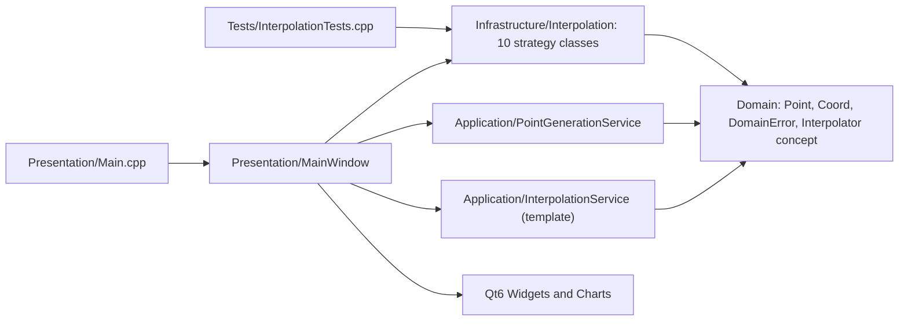

# InterpolationApp — documentation hub

InterpolationApp is a Qt6 desktop program written in C++23 that generates a set of
random 2D points and plots them together with the curve produced by one of ten
interpolation or smoothing methods (`src/Presentation/MainWindow.cpp:107-118`). The
algorithms are header-only classes that share one contract, so the same code is used by
the window and by a doctest/nanobench test executable (`src/Tests/InterpolationTests.cpp`).
Who the intended users are is not stated in the repository (see
[Open questions in SPEC.md](../SPEC.md#9-open-questions)).

The requirements reverse-engineered from the code are in [`../SPEC.md`](../SPEC.md).

## 1. Status

- Last commit touching the project's own code (`src/`, `CMakeLists.txt`, `Doxyfile`):
  `28a518a`, 2025-12-20. The README followed in `1783227` the same day. All later commits
  (2026-08-05 to 2026-08-07, up to `5670e81`) add the licence and shared tooling only
  (`git log`).
- Tests: one doctest file with 11 test cases — one per method plus a `Benchmarks` case
  (`src/Tests/InterpolationTests.cpp`). They are built as `tests_run` when `BUILD_TESTING`
  is ON (`CMakeLists.txt:16,63-81`). `enable_testing()` is called but no `add_test()`
  exists, so `ctest` has nothing registered (`CMakeLists.txt:19`).
- CI: only a gitleaks secret scan (`.github/workflows/secret-scan.yml`). No workflow
  builds the code or runs `tests_run`. The README badge "Status: Verified"
  (`README.md:5`) is not backed by a CI job.
- Evidently unfinished: CMake comment "Add other sources here as we create them"
  (`CMakeLists.txt:44`); Akima spline boundary slopes are "simplified"
  (`src/Infrastructure/Interpolation/AdditionalInterpolators.h:232-245`); the combo item
  "Sinc (Lanczos)" has no Lanczos window in the code (`AdditionalInterpolators.h:311-352`).

## 2. Layout

| Path | Content |
| --- | --- |
| `src/Domain/Model/Point.h` | `Coord` and `Point` value types |
| `src/Domain/Ports/Interpolator.h` | `DomainError` and the `Interpolator` concept |
| `src/Application/UseCases/InterpolationService.h` | Template service that runs one strategy |
| `src/Application/UseCases/PointGenerationService.h` | Random-point and sine-wave generators |
| `src/Infrastructure/Interpolation/LinearInterpolator.h` | Linear method |
| `src/Infrastructure/Interpolation/AdditionalInterpolators.h` | The other nine methods |
| `src/Presentation/Main.cpp` | `main()`: creates `QApplication` and the window |
| `src/Presentation/MainWindow.h`, `MainWindow.cpp` | Window, chart, control dock |
| `src/Tests/InterpolationTests.cpp` | doctest cases and nanobench benchmarks |
| `CMakeLists.txt` | Targets `InterpolationApp` and `tests_run` |
| `Doxyfile` | Doxygen configuration (HTML with Graphviz graphs) |
| `.clang-format`, `.clangd` | Formatting style and clangd flags |

## 3. Architecture

Four layers under `src/`, header-only except the presentation layer
(`CMakeLists.txt:41-45` compiles only `Main.cpp` and `MainWindow.cpp`).



Data flow in the window (`src/Presentation/MainWindow.cpp:141-199`):

1. "Generate" calls `PointGenerationService::generateRandomPoints(count, 0, 100, 0, 100)`;
   the points are sorted by x and stored in `currentPoints`.
2. `updateInterpolation()` re-plots the points, wraps the selected strategy in
   `InterpolationService<T>` and calls `execute(points, steps)`.
3. The result is a `std::expected<std::vector<Point>, DomainError>`. On success the
   points are drawn as a line; on error the line stays empty. The elapsed time of the
   call is shown in microseconds.

No network, hardware or direct file I/O is used by the application. The only persisted
state is the window geometry in `QSettings` (`MainWindow.cpp:46-48,54-58`).

## 4. Build and run

Prerequisites:

| Item | Version / source |
| --- | --- |
| CMake | 3.28 or newer (`CMakeLists.txt:1`) |
| C++ compiler | C++23, extensions off (`CMakeLists.txt:4-6`); README names Clang 16+ or GCC 11+ (`README.md:53`), not verified here |
| Qt6 | Components Core, Gui, Widgets, Charts (`CMakeLists.txt:13`); README says "6.x" |
| doctest v2.4.11, nanobench v4.3.11 | Downloaded by FetchContent at configure time when `BUILD_TESTING` is ON (`CMakeLists.txt:23-37`), so configuring needs network access |
| Doxygen, Graphviz | Optional, for documentation (`Doxyfile:14`, `README.md:54`) |
| Google Chrome | Optional; the benchmark case calls `google-chrome` (`InterpolationTests.cpp:192-196`) |

Build (`README.md:57-67`):

```bash
mkdir build && cd build
cmake .. -DCMAKE_BUILD_TYPE=Release
cmake --build .
```

Run the application (`README.md:72`): `./InterpolationApp`

Run tests and benchmarks (`README.md:78`): `./tests_run`

Generate API documentation (`README.md:89-90`): `doxygen Doxyfile`, then open
`docs/html/index.html`.

## 5. Configuration

The project reads no environment variables and defines no command-line flags of its own;
`argc`/`argv` are passed to `QApplication` (`src/Presentation/Main.cpp:11-12`).

| Name | Where | Meaning | Default |
| --- | --- | --- | --- |
| `BUILD_TESTING` | `CMakeLists.txt:16` | Fetch doctest/nanobench and build `tests_run` | `ON` |
| `CMAKE_BUILD_TYPE` | `README.md:66` | Build type used in the README example | not set in `CMakeLists.txt` |
| `QSettings("MyCompany", "InterpolationApp")`, keys `geometry`, `windowState` | `MainWindow.cpp:46-48,54-58` | Window size, position and dock layout | restored at start, saved on exit |
| `Doxyfile` | repository root | `INPUT = src`, `FILE_PATTERNS = *.h *.hpp *.hxx *.ixx`, output `docs/html` | — |
| `.clang-format` | repository root | Google style, 120 columns, indent 4 | — |
| `.clangd` | repository root | `-std=c++23 -Wall -Wextra -Wpedantic -Werror`, strict include diagnostics | — |

## 6. Usage

Interactive (`MainWindow.cpp:84-139`):

1. Start `InterpolationApp`; it opens maximised (`Main.cpp:15`). No points are generated
   until "Generate" is pressed (`MainWindow.cpp:50-51`).
2. Set "Random Points" (2 to 100000, default 10) and press "Generate".
3. Pick a method in "Method" and set "Steps" (10 to 5000, default 100); every change
   re-runs the interpolation.
4. Read the call time in the label "Time: N µs".

Minimum point counts per method (an error, and an empty curve, below them):
Linear, Lagrange, Cosine, Moving Average — 2; Cubic Spline — 3; Catmull-Rom — 4;
Akima — 5; Nearest Neighbor, Step, Sinc — 1 (details in [SPEC.md §4.1](../SPEC.md#41-c-api)).

Using a strategy from C++ (pattern of `src/Tests/InterpolationTests.cpp:25-33`):

```cpp
Infrastructure::Interpolation::LinearInterpolator interp;
std::vector<Domain::Model::Point> pts{{{0}, {0}}, {{10}, {10}}};
auto result = interp.interpolate(pts, 20);   // 20 points, x from 0 to 10
if (result) { /* result->size() == 20 */ } else { /* result.error().message */ }
```

## 7. Testing

`tests_run` is a doctest executable whose `main` comes from a runner file that CMake writes
at configure time (`CMakeLists.txt:65-76`). Coverage of the 10 test cases
(`src/Tests/InterpolationTests.cpp:25-135`):

- Value checks: Linear (size, end points, midpoint within a 50 % tolerance), Nearest
  Neighbor (end values), Lagrange (y = 4 at x = 2 for points on y = x²), Moving Average
  (index 2 ≈ 6.666).
- Only `has_value()` is checked for Catmull-Rom, Cubic Spline, Akima, Cosine and Sinc.
- Step: the value checks are guarded by `|x - 2.5| < 0.1` and `|x - 7.5| < 0.1`, but with
  20 steps on [0, 10] the grid spacing is 10/19 and no grid point falls inside those
  windows (computed with a scratch program, see §11), so only `has_value()` is effective.
- No test covers error paths, `PointGenerationService`, `InterpolationService` or the UI.

The `Benchmarks` case (`InterpolationTests.cpp:137-196`) runs every method on 100 points
with 100000 output steps (Lagrange: 10 points, 1000 steps), writes
`benchmark_results_optimized.html` to the current directory and starts `google-chrome`
through `std::system`. It runs whenever `tests_run` runs. It has no time thresholds.

## 8. Known limitations and problems

- The UI never shows `DomainError::message`; below their minimum (Cubic Spline 3,
  Catmull-Rom 4, Akima 5 points; the spin box allows 2) these methods silently draw
  nothing (`MainWindow.cpp:184-190`, spin minimum at `:94`).
- Before the first "Generate", changing method or steps runs on an empty set and the axes
  are set from the initial sentinels to the range (1e9 − 5, −1e9 + 5)
  (`MainWindow.cpp:149,198-199`). How QtCharts displays that was not checked.
- The UI method order differs from the README list (Step is the 6th combo item,
  `MainWindow.cpp:113`, item 3 in `README.md:21-30`).
- "Sinc (Lanczos)" computes an unwindowed normalised sinc sum with the average point
  spacing as period (`AdditionalInterpolators.h:330-349`).
- Only Linear and Moving Average (which resamples through Linear,
  `AdditionalInterpolators.h:381-383`) reject `steps <= 0`. The other methods return an
  empty vector for `steps == 0`; for negative `steps`, Nearest Neighbor, Step, Lagrange
  and Cubic Spline throw `std::length_error` from `reserve(steps)`
  (`AdditionalInterpolators.h:49,83,119,185`) and the rest return an empty vector
  (observed in a scratch run). The UI cannot send such values (`MainWindow.cpp:124`).
- `generateSineWave(1, …)` divides by `count - 1` and returns x = NaN (observed in a
  scratch run, `PointGenerationService.h:62`). The function is used nowhere in the
  repository.
- `AdditionalInterpolators.h:381` uses `LinearInterpolator` without including
  `LinearInterpolator.h`; it compiles only when that header is included first, as in
  `MainWindow.cpp:12-13` and `InterpolationTests.cpp:10-11`.
- Lagrange costs O(N²) per output point (`AdditionalInterpolators.h:100,124-130`) while
  the UI allows N = 100000 and 5000 steps; the time at that size was not measured.
- Random points are seeded from `std::random_device` (`PointGenerationService.h:36-37`);
  there is no way to reproduce a point set.
- In the Lagrange test `found` is assigned but never checked
  (`InterpolationTests.cpp:62-68`); `#define DOCTEST_CONFIG_IMPLEMENT_WITH_MAIN` at
  `InterpolationTests.cpp:42` comes after the doctest include and has no effect.
- Doxygen reads header patterns only (`Doxyfile:5`), so `Main.cpp`, `MainWindow.cpp` and
  the tests are not in the generated documentation.
- `-Werror` and the warning flags apply to the `InterpolationApp` target only, not to
  `tests_run` (`CMakeLists.txt:56-61,73-80`).

## 9. Repository tooling

The repository carries part of the shared tooling from
[repo-quality-template](https://github.com/IGORSVOLOHOVS/repo-quality-template), added in
commit `a7a4c20` (2026-08-05). No template revision is stated in `README.md`, and there is
no `CLAUDE.md`. What is specific here:

- No `recipe.ps1`, so there are no `$App`/`$Provides` variables or recipe verbs; no
  `.claude/`, `CHANGELOG.md`, `CODE_OF_CONDUCT.md` or build/test CI workflow.
- The one workflow is `.github/workflows/secret-scan.yml` (gitleaks on push, pull request
  and manual dispatch).
- The `scripts/*.py` and `CONTRIBUTING.md` are the Python-project versions from an earlier
  template revision. They refer to files this C++ repository does not have:
  `pyproject.toml` (`scripts/collect_quality_metrics.py:150`), `.github/workflows/ci.yml`
  (`:156`), `requirements-dev.lock` (`scripts/install_dependencies.py:21`), the
  `quality_template` package (`scripts/profile_application.py:22`), and a pytest/ruff loop
  (`CONTRIBUTING.md:17-25`). `python scripts/check_before_push.py` reports
  "NOT CHECKED: CI here runs no lint or test step this script can mirror."
- `.pre-commit-config.yaml` runs ruff (which only reaches `scripts/*.py` here) and has no
  clang-format hook, although `.clang-format` exists.

## 10. Related documents

- [`../README.md`](../README.md) — project README
- [`../SPEC.md`](../SPEC.md) — requirements specification
- [`branching.md`](branching.md) — branch policy (tooling)
- [`../CONTRIBUTING.md`](../CONTRIBUTING.md), [`../SECURITY.md`](../SECURITY.md) — tooling documents
- [`../LICENSE`](../LICENSE) — MIT licence
- [`../Doxyfile`](../Doxyfile) — API documentation configuration; output `docs/html/` is not tracked (`.gitignore`)

## 11. About this document

Written 2026-11-18 from commit `5670e81` (branch `docs/spec-and-docs`, from `origin/dev`).

Commands run: `git ls-files`, `git log` (with `--stat` and path filters), `git show --stat
28a518a`, `git branch -a`, `git status`; `diff --strip-trailing-cr` of the tooling files
against a clone of repo-quality-template; `python -I scripts/check_before_push.py`
(report mode) and `python -I scripts/enforce_branch_policy.py --help`; a scratch C++
program outside the repository that includes the six headers under `src/Domain`,
`src/Application` and `src/Infrastructure`, compiled with `clang++ -std=c++23` (clang
20.1.0, Windows) and run, to observe the error messages, the `steps` edge cases, the
sine-wave NaN and the Step test grid.

Not run: CMake configure or build (needs Qt6 and network for FetchContent), `tests_run`,
the application, `doxygen` (not installed on the machine), `pre-commit`, and the other
`scripts/*.py`.
